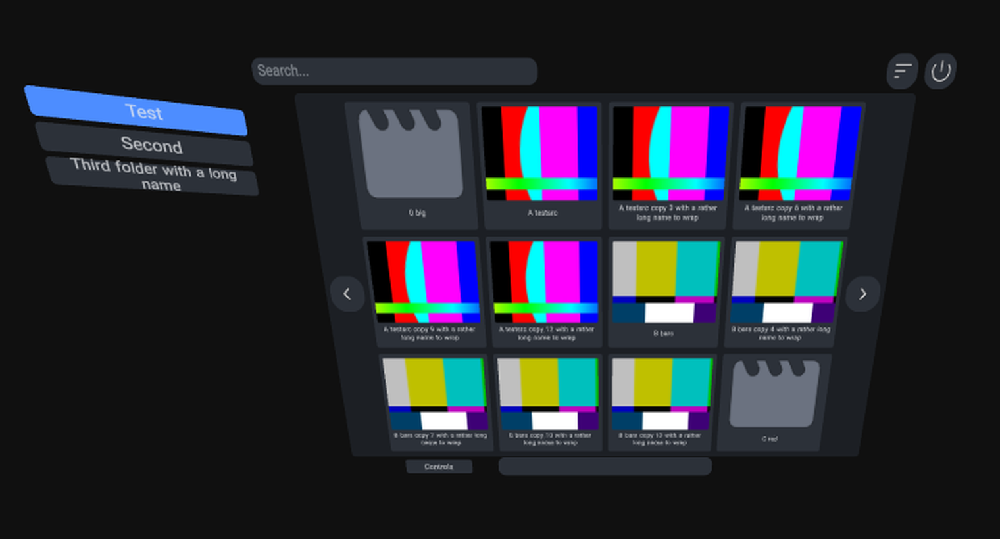
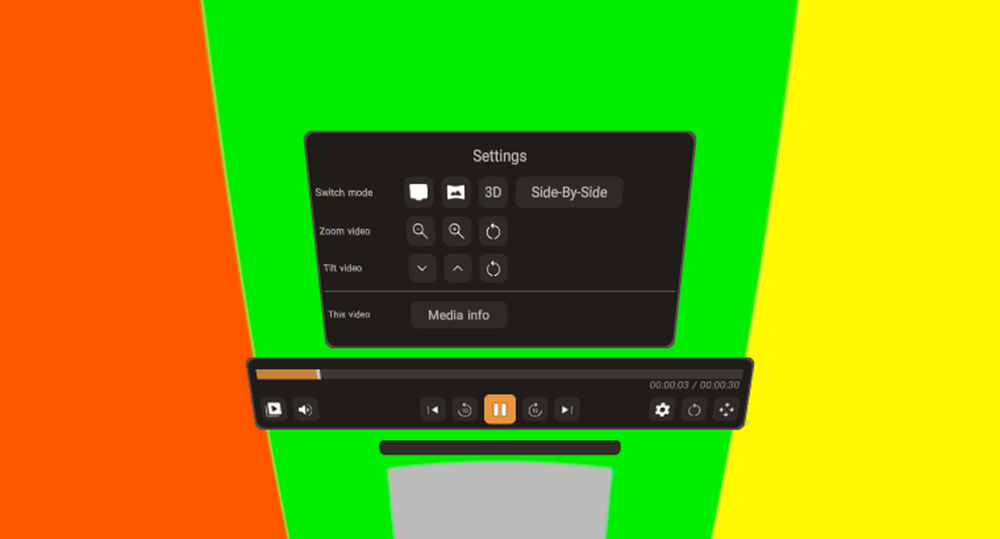

# Projectionist

*Since it was forked, this project has been vibe-coded: its code and docs are written by Claude, an AI.*

Projectionist is a video player for VR headsets that runs in the headset's browser, for your own library of 180° and 360° videos. You serve a folder of videos from your own server, open the player's page in the headset, and browse and play them in VR. Nothing is uploaded anywhere, and there is no app to install on the headset.

It began as a fork of [michal-repo/web_vr_video_player](https://github.com/michal-repo/web_vr_video_player) and has been largely rewritten since.



## What it does

- **Library:** one folder per category, thumbnails, search, and sorting by name or date. Thumbnails and media info follow a video's content, so they survive renaming and moving files.
- **Formats:** side-by-side and top-bottom 180°, top-bottom 360°, 180° and 360° 2D, and flat videos on a virtual screen.
- **Player:** seek bar, ±10 s, previous and next video, zoom and tilt of the screen, a media info page (resolution, codecs, bitrate), and a spinner while the video buffers.
- **Controllers:** the thumbstick zooms and seeks, A plays and pauses, B goes back to the library; holding the grip shows the extra controls. Search uses the headset's own keyboard, in your layout, where the browser offers it.
- **Runs anywhere static files can be served:** the player is a static site. A small Python script, run whenever the library changes, writes the catalogue and the thumbnails.

Tested with a Meta Quest 2 in Quest Browser. Other WebXR browsers should work, but haven't been tried.



## Install from a release

You need a server that keeps your videos and can serve files over HTTPS (browsers only allow VR on HTTPS pages), with Python 3 and FFmpeg installed. These steps use Nginx; any web server that supports HTTP range requests works.

1. Download `projectionist-vr-<version>.tar.gz` from the [latest release](../../../releases/latest) and extract it on the server, for example to `/srv/vr-player/`. It holds the site (`dist/`), the scripts (`scripts/`) and two example configuration files.
2. Copy `config.ini.example` to `config.ini` and set:
   - `videos_path`: the folder holding your videos, one subfolder per category;
   - `thumbnails_path`: a folder the scripts can write to, for the thumbnails and media info;
   - `site_url_prefix`: the address path the player will have, such as `/vr-player`.
3. Generate the thumbnails, then the catalogue:
   ```bash
   python3 scripts/generate_thumbs.py config.ini
   python3 scripts/generate_json.py config.ini
   ```
   The catalogue is written to `dist/files.json`. Run both again whenever you add, move or delete videos; a cron job or a systemd timer can do it for you.
4. Set up the web server from `nginx.conf.example`: it serves `dist/` at the site path, and your videos and thumbnails below it. The paths in it must match `config.ini`.
5. In the headset's browser, open the player's address (for example `https://your-server/vr-player/`) and press the VR button.

To update, extract the new release over the old one; your `config.ini` and catalogue are kept. If videos don't play, see [Troubleshooting](troubleshooting.md).

## More documentation

- [Using the player](using-the-player.md): the library, the player and every controller control.
- [Catalogue and video formats](catalogue.md): what `files.json` holds, and how to set a video's format.
- [Prepare media for streaming](media-preparation.md): thumbnails, making MP4s start fast, converting AV1 for the Quest 2.
- [Deploy with Nginx](deployment.md): releases and serving it in more detail.
- [Build from source](getting-started.md): requirements, configuration and local development.
- [Troubleshooting](troubleshooting.md)
- [Vendored dependencies](vendored-dependencies.md)

## Licences and credits

The code is under the [MIT License](../LICENSE), as was the original project by michal-repo. The icons are Google's Material Symbols and the font is Roboto, both under the Apache License 2.0: see [third-party-assets.md](third-party-assets.md).
