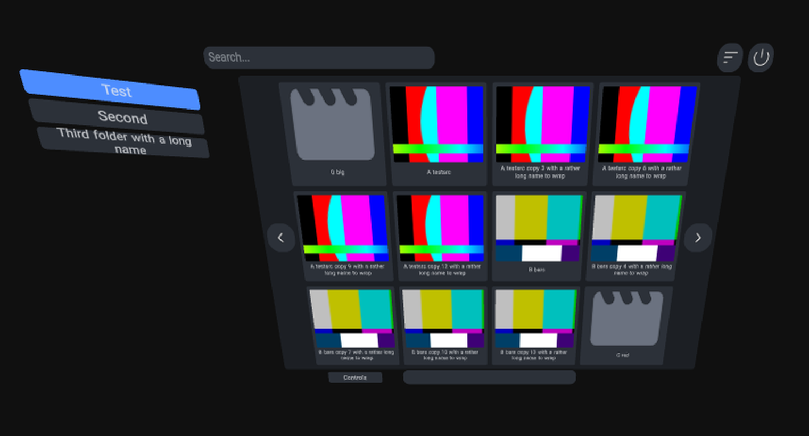
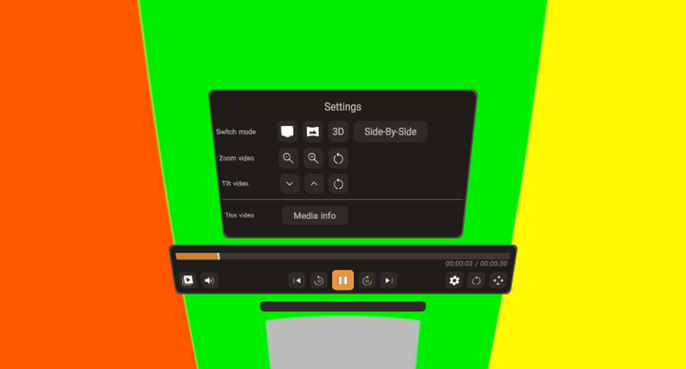
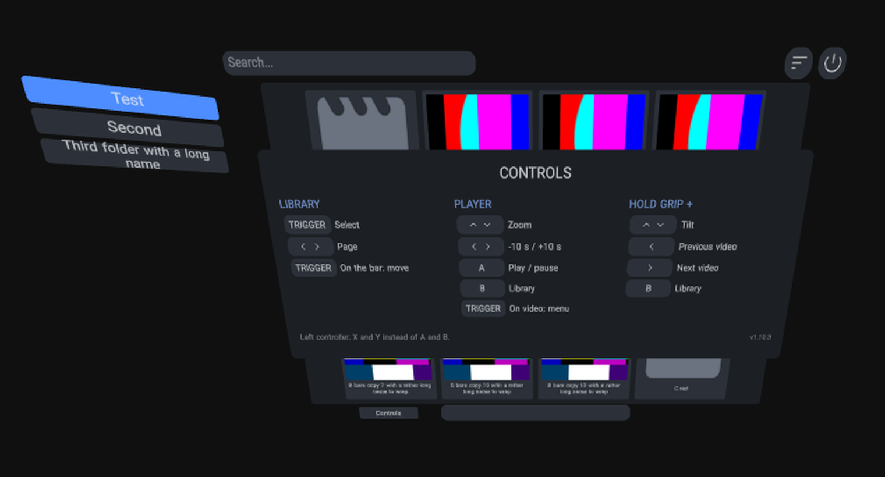

# Using the player

## Library features

- Browse video categories generated from the library directory structure.
- Search and sort the current category.
- Play SBS, top-bottom, 360°, fisheye, and flat entries from `files.json`.
- Select a video, then wait for browser media metadata before switching into
  the player.
- While the catalogue loads, a spinner and "Loading library..." show; the
  library opens as soon as it has loaded.
- A video you leave and open again resumes where you left it, as long as the
  page stays open. Reloading the page forgets every position; a video watched
  to the end starts again from the beginning.

### Search and sorting

The search bar sits above the library. Select it to type on the headset's own
keyboard, in your layout and language (Quest Browser 26.1 and later); closing
the keyboard searches the current folder by name. Where the browser can't show
its keyboard over VR, and outside VR, the player shows its own on-screen
keyboard instead: press Enter, or select the bar again, to search. The phrase
stays active when you switch folders; the X at the end of the bar clears it.

The sort button at the top right, beside the power button, opens a menu: name
A to Z or Z to A, newest or oldest first. Names sort as people read them, so
"Part 2" comes before "Part 10". The current order is highlighted, and a click
outside the menu closes it.

### Reposition views

In the Folders view, hold the trigger and drag the bottom bar to reposition it.

In Player view, the same gesture repositions the controls and video spheres.
You can instead reposition only the player controls. Controls and spheres reset
to their default position when you exit the current video.

## Controls

The Controls button under the library opens a panel listing the controls
below, and the player's version at its bottom right; a click outside it closes it. While you hold the grip, a popup above the controller lists what the
grip combinations do there.
Resting the pointer on a button shows what it does.

On the left controller, X and Y take the place of A and B. If two controllers
are connected, pull the trigger on the other one to point with it instead.

### Library

- Trigger: select. On the bar under the library, hold it to move the library.
- Thumbstick left or right: previous or next page.
- Grip + B, or the power button at the top-right of the library: leave VR.

### Player

- Thumbstick up or down: zoom. The browser remembers your zoom for later
  videos; before you first change it, SBS playback starts at the configured
  `default_sbs_zoom`. Leaving VR, for instance when the headset sleeps, keeps
  the zoom.
- Thumbstick left or right: back or forward 10 seconds. While the video seeks or waits for data, a small spinner shows ahead of you.
- Pointing at the seek bar shows the time there and, when the catalogue has seek thumbnails for the video, its frame.
- A: play or pause. B: back to the library.
- Trigger on the video: show or hide the player controls.
- The gear opens the settings window: screen mode, zoom and tilt, and Media
  info, which shows the video's resolution, codecs, frame rate, audio,
  duration, size and bitrate from the catalogue, and in red when the video
  starts slowly for lack of fast start. The arrow at the top left goes
  back a page; a click anywhere outside the window closes it.
- Grip + thumbstick up or down: tilt the screen.
- Grip + thumbstick left or right: previous or next video in the library's
  current list, as searched and sorted. The arrow buttons at either end of the
  playback buttons do the same.
- Grip + B: back to the library, as B does. From the library, a new press
  leaves VR; holding the first one keeps you in the library.
- The reset button puts the screen and the controls back in place, with the
  configured default zoom.

## Screenshots

